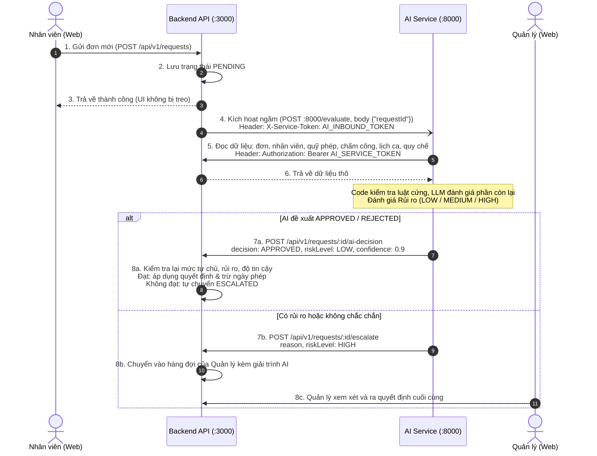

# TÀI LIỆU BÀN GIAO & HƯỚNG DẪN KẾT NỐI AI SERVICE
> **Phiên bản:** 1.1 (đối chiếu lại với code `apps/api` và `apps/ai`)  
> **Dành cho:** Kỹ sư / Đội ngũ phát triển AI Service (`apps/ai`)  
> **Dự án:** Hệ thống Quản trị Nhân sự Doanh nghiệp Hiện đại (Enterprise HRMS)  
> **Trạng thái:** Backend API & Frontend Web đã kết nối với AI Service, đã chạy thử end-to-end (AI tự duyệt đơn nghỉ phép rủi ro thấp).  
> Contract chi tiết (lý do thiết kế, idempotency, trace): xem `docs/06-ai-integration.md`.

---

## 1. TỔNG QUAN KIẾN TRÚC TÍCH HỢP

Hệ thống được thiết kế theo kiến trúc tách rời (Decoupled Architecture), giao tiếp giữa Backend API (`apps/api`) và AI Service (`apps/ai`) thông qua giao thức HTTP RESTful được bảo vệ bởi **Cặp Service Token 2 chiều**:



---

## 2. THÔNG TIN BẢO MẬT & CẤU HÌNH TOKEN NỘI BỘ

Hai dịch vụ giao tiếp nội bộ thông qua cặp Secret Token. Giá trị dưới đây chỉ dùng cho máy local; khi deploy thật phải đổi sang giá trị ngẫu nhiên mới.

| Tên biến môi trường | Đặt ở | Giá trị mặc định (Local/Docker) | Mục đích sử dụng |
|---|---|---|---|
| `AI_SERVICE_TOKEN` | API và AI | `ai-service-secret-token-hr-2026` | **AI gọi vào API**: header `Authorization: Bearer ...`. API chỉ đọc header này. |
| `AI_INBOUND_TOKEN` | API và AI | `ai-inbound-secret-token-hr-2026` | **API gọi sang AI**: header `X-Service-Token: ...` khi gọi `/evaluate`. |
| `API_BASE_URL` | AI | `http://localhost:3000` (Local) <br/> `http://api:3000` (Docker) | Địa chỉ gốc của Backend API, **không** kèm `/api/v1` (AI tự nối thêm). |
| `AI_API_BASE_URL` | API | `http://localhost:8000` (Local) <br/> `http://ai:8000` (Docker) | Địa chỉ gốc của AI Service. Không đặt thì API dùng `http://127.0.0.1:8000`. |
| `OPENAI_API_KEY` | AI | (để trống trong file mẫu) | Key LLM. Đặt trong `apps/ai/.env` (local) hoặc `.env` ở gốc repo (Docker). Không commit. |

> Lưu ý: `apps/api/.env.example` đang ghi `AI_SERVICE_URL`, nhưng code API đọc `AI_API_BASE_URL`.

Cấu hình LLM của AI (`LLM_PROVIDER`, `LLM_MODEL`, `LLM_FALLBACK_MODELS`, `LLM_TIMEOUT_S`): xem `apps/ai/.env.example`. Để trống thì dùng OpenAI `gpt-5.6-luna`, dự phòng `gpt-6-luna`.

---

## 3. DANH SÁCH API CONTRACTS DÀNH RIÊNG CHO AI SERVICE

Mọi endpoint dưới đây có tiền tố `/api/v1` và xác thực bằng `Authorization: Bearer <AI_SERVICE_TOKEN>`. Khi đó API coi người gọi là `{ id: 'ai-service', role: 'AI' }`.

### 3.1. Gửi Quyết định Tự động (AI ➔ API)
* **Endpoint:** `POST /api/v1/requests/:id/ai-decision`
* **Body Request mẫu:**
```json
{
  "decision": "APPROVED",
  "reason": "Nhân viên còn đủ ngày phép năm, đơn tạo trước 7 ngày, không trùng đơn nghỉ khác.",
  "riskLevel": "LOW",
  "confidence": 0.9,
  "policyRefs": ["LEAVE.NOTICE_DAYS"],
  "idempotencyKey": "ai-eval:<requestId>:<updatedAt>",
  "trace": {
    "mode": "DECISION",
    "model": "gpt-5.6-luna",
    "promptVersion": "...",
    "toolCalls": []
  }
}
```
* **Các giá trị hợp lệ:**
  - `decision`: `'APPROVED'` | `'REJECTED'`
  - `riskLevel`: `'LOW'` | `'MEDIUM'` | `'HIGH'`
  - `confidence`: số thực từ `0.0` đến `1.0`
  - `policyRefs`, `idempotencyKey`, `trace`: không bắt buộc
* **API kiểm tra lại trước khi áp dụng:** mức tự chủ của loại đơn (`AutonomyConfig`, mặc định `SUGGEST_ONLY`), `riskLevel` phải là `LOW`, `confidence` ≥ `minConfidence` (mặc định `0.85`). Không đạt thì đơn chuyển `ESCALATED`.
* **Response (201):**
```json
{ "id": "d8fee2db-...", "status": "APPROVED", "applied": true, "decidedBy": "AI" }
```
  - Không đạt điều kiện tự chủ: `{ "id", "status": "ESCALATED", "applied": false, "escalationReason": "..." }`
  - Gửi lại cùng `idempotencyKey` khi đơn đã có quyết định: trả lại trạng thái hiện tại, `applied` = trạng thái có khớp `decision` hay không.
  - Đơn không còn `PENDING` và không có `idempotencyKey`: `409` với `code: "INVALID_TRANSITION"`.

---

### 3.2. Chuyển cấp cho Con người (AI ➔ API)
* **Endpoint:** `POST /api/v1/requests/:id/escalate`
* **Body Request mẫu:**
```json
{
  "reason": "Nhân viên đã nghỉ 5 lần trong 2 tuần, cần quản lý xem xét.",
  "riskLevel": "HIGH",
  "idempotencyKey": "ai-eval:<requestId>:<updatedAt>",
  "trace": { "mode": "DECISION", "model": "gpt-5.6-luna", "promptVersion": "..." }
}
```
* `reason` bắt buộc; `riskLevel`, `idempotencyKey`, `trace` không bắt buộc.

---

### 3.3. Đọc Dữ liệu Quẹt thẻ Chấm công thô (AI ➔ API)
* **Endpoint:** `GET /api/v1/attendance/events`
* **Query Parameters:**
  - `employeeId` (string, UUID): Mã nhân viên cần tra cứu
  - `from` (string, `YYYY-MM-DD`)
  - `to` (string, `YYYY-MM-DD`, tính cả ngày này)
* **Response (200 OK):** sắp xếp theo `timestamp` tăng dần
```json
[
  {
    "id": "cf7ea4be-89fa-4d99-a03b-08bfe782fb65",
    "employeeId": "db5c74fa-67eb-4fc3-9331-422807c76a72",
    "type": "CLOCK_IN",
    "timestamp": "2026-11-02T01:30:00.000Z"
  },
  {
    "id": "087303d6-7436-4143-acac-a9cd0d0a5543",
    "employeeId": "db5c74fa-67eb-4fc3-9331-422807c76a72",
    "type": "CLOCK_OUT",
    "timestamp": "2026-11-02T10:30:00.000Z"
  }
]
```

---

### 3.4. Đọc Lịch phân ca (AI ➔ API)
* **Endpoint:** `GET /api/v1/shifts/schedules`
* **Query Parameters:**
  - `employeeId` (string, UUID): lịch ca của một nhân viên, **hoặc**
  - `departmentId` (string, UUID): lịch ca của toàn bộ nhân viên trong phòng
  - `from`, `to` (string, `YYYY-MM-DD`, tính cả hai đầu)
* **Response (200 OK):** sắp xếp theo `date` tăng dần
```json
[
  {
    "id": "schedule-uuid-1",
    "employeeId": "emp-uuid-1",
    "date": "2026-11-02T00:00:00.000Z",
    "shiftStart": "2026-11-02T01:30:00.000Z",
    "shiftEnd": "2026-11-02T10:30:00.000Z",
    "employee": {
      "id": "emp-uuid-1",
      "fullName": "Nguyễn Văn A",
      "email": "...",
      "department": { "id": "...", "name": "..." },
      "position": { "id": "...", "title": "..." },
      "defaultShift": "..."
    }
  }
]
```

---

### 3.5. Chat (API ➔ AI)
* **Endpoint:** `POST {AI_API_BASE_URL}/api/chat`, header `X-Service-Token: <AI_INBOUND_TOKEN>`. Web gọi qua `POST /api/v1/agent/chat`.
* **Body:** `{ "employeeId": "...", "message": "Cho tôi nghỉ phép ngày 15/12 để về quê", "conversationId": "..." }`
* **Response (200):**
```json
{
  "conversationId": "9b1c…",
  "reply": "Mình đã soạn đơn nghỉ phép năm (15/12/2026). Bạn kiểm tra thẻ bên dưới rồi bấm “Xác nhận gửi duyệt” nhé.",
  "citationKeys": [],
  "actionCard": {
    "id": "…", "type": "REQUEST_DRAFT", "title": "Đơn nghỉ phép năm", "requestType": "LEAVE",
    "data": { "typeName": "Nghỉ phép năm", "leaveType": "ANNUAL", "dates": "15/12/2026", "durationText": "1 ngày làm việc", "daysCount": 1, "reason": "về quê" },
    "payload": { "leaveType": "ANNUAL", "startDate": "2026-12-15", "endDate": "2026-12-15", "reason": "về quê" },
    "policyChecks": [{ "rule": "HARD_RULES", "passed": true, "description": "Đạt các luật cứng của công ty cho loại đơn này" }],
    "riskLevel": "LOW", "status": "draft"
  }
}
```
* Chi tiết (lịch sử hội thoại, lỗi 502/503, cách web gửi đơn từ thẻ): `docs/06-ai-integration.md` §7.

---

### 3.6. Các endpoint đọc khác AI dùng
| Endpoint | Dùng để |
|---|---|
| `GET /api/v1/requests/:id`, `GET /api/v1/requests` | Đọc đơn cần chấm và lịch sử đơn của nhân viên |
| `GET /api/v1/employees/:id` | Thông tin nhân viên (phòng ban, ngày vào làm, thử việc) |
| `GET /api/v1/leave/balance` | Quỹ phép |
| `GET /api/v1/shifts/templates` | Mẫu ca làm việc |
| `GET /api/v1/policy` (alias `/policies`) | Quy chế công ty, đưa vào prompt làm căn cứ |
| `GET /api/v1/agent/autonomy-config` | Mức tự chủ của từng loại đơn |

---

## 4. HƯỚNG DẪN KHỞI CHẠY KIỂM THỬ NHANH (QUICKSTART)

### Bước 1: Khởi động Cơ sở dữ liệu & Cache
```bash
docker compose up -d postgres redis
```
*(Postgres chạy tại port 5432, Redis tại port 6379).*

### Bước 2: Chuẩn bị và chạy Backend API
```bash
cp apps/api/.env.example apps/api/.env   # thêm AI_API_BASE_URL=http://localhost:8000
npm install
npm run prisma:generate   # npm bản mới chặn install script của Prisma, phải chạy tay
npm run db:push           # tạo bảng trong Postgres
npm run seed:api          # tạo tài khoản mẫu
npm run dev:api
```
*(API khởi động tại: `http://localhost:3000`).*

### Bước 3: Chạy AI Service
Không có script `npm run dev:ai`. Chạy trong thư mục `apps/ai` (Python 3.12+):
```bash
cd apps/ai
python -m venv .venv
.venv/Scripts/pip install -r requirements.txt   # Linux/macOS: .venv/bin/pip
cp .env.example .env                            # điền OPENAI_API_KEY; hoặc LLM_PROVIDER=fake để chạy không tốn token
.venv/Scripts/python -m uvicorn app.main:app --port 8000
```
*(AI Service lắng nghe tại: `http://localhost:8000`, kiểm tra bằng `GET /health`).*

### Bước 4: Chạy Giao diện Web
```bash
npm run dev:web
```
*(Web mở tại: `http://localhost:5173`).*

**Chạy toàn bộ bằng Docker:** `cp .env.example .env`, điền `OPENAI_API_KEY`, rồi `docker compose up`. Container API không tự tạo bảng: lần đầu chạy `npm run db:push` và `npm run seed:api` từ máy host như Bước 2.

---

## 5. TÀI KHOẢN MẪU KIỂM THỬ (TEST ACCOUNTS)

Tạo bởi `npm run seed:api` (`apps/api/prisma/seed.ts`):

| Vai trò | Email đăng nhập | Mô tả & Thẩm quyền |
|---|---|---|
| **ADMIN** | `admin@gmail.com` | Quản trị toàn hệ thống, cấu hình quy chế, quản lý phân quyền, cấu hình tự trị AI. |
| **HR** | `huyhoang@gmail.com` | Phòng nhân sự, tạo nhân viên mới, xem toàn bộ đơn từ và nhật ký kiểm toán. |
| **MANAGER** | `tiendung@gmail.com` | Quản lý phê duyệt đơn từ của cấp dưới trực tiếp. |
| **EMPLOYEE** | `minhphong@gmail.com` | Nhân viên nộp đơn xin nghỉ, quẹt thẻ chấm công, đổi ca, làm thêm giờ OT. |

---

## 6. ĐẦU MỐI HỖ TRỢ KỸ THUẬT

- Toàn bộ các API trên đều đã được xác minh kiểm thử tự động đạt **Exit Code 0** và không có lỗi biên dịch.
- Nếu cần bổ sung thêm tham số hoặc trường dữ liệu đặc thù nào cho mô hình học máy, phía Backend API có thể điều chỉnh và mở rộng tức thì.
